<a href="https://findress.vercel.app">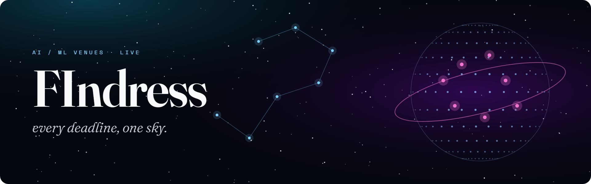</a>

<p align="center">
  <b>Every AI/ML conference, workshop and journal in one live view.</b><br>
  <sub>Deadlines in your timezone · CORE &amp; CCF ranks · acceptance rates · calls for papers · an assistant that reads them for you</sub>
</p>

<p align="center">
  <a href="https://findress.vercel.app"></a>
  <a href="https://github.com/Xenomorph27/Findress/actions/workflows/ci.yml"></a>
  
  
  <a href="LICENSE"></a>
</p>

<p align="center">
  <a href="#features">Features</a> · <a href="#screenshots">Screenshots</a> · <a href="#architecture">Architecture</a> · <a href="#run-locally">Run locally</a> · <a href="#api">API</a>
</p>

<picture>
  <source media="(prefers-color-scheme: light)" srcset="docs/screenshots/home-light-1440.png">
  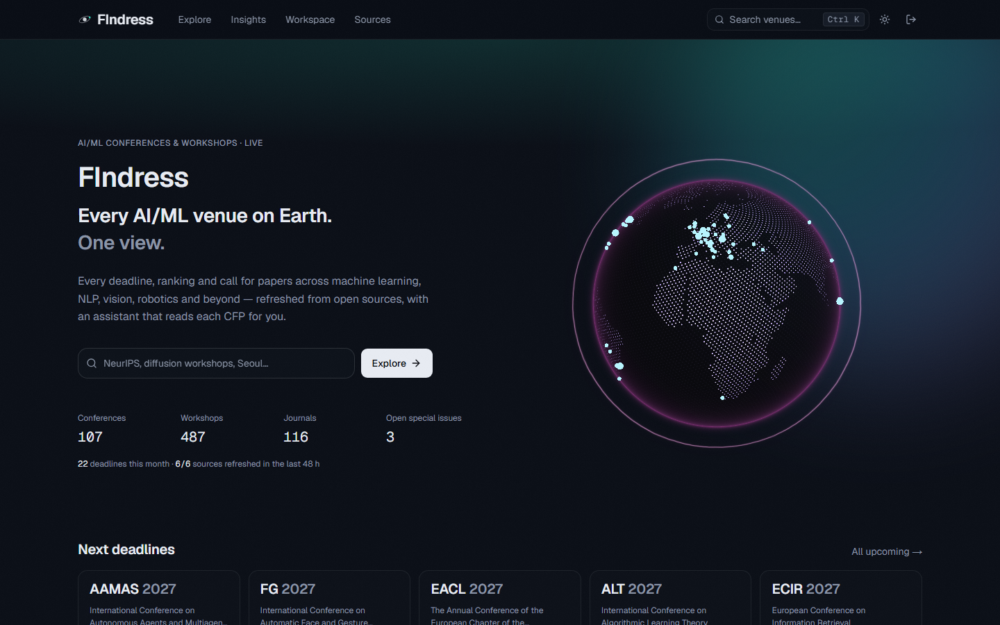
</picture>

## Changelog

| When | What shipped |
|---|---|
| **Oct 22, 2026** | New sources and smarter data — **EasyChair Smart CFP** with an AI/ML relevance filter, **SJR quartiles** matched by ISSN, evidence-bound extraction of deadlines from CFP pages, and a resumable OpenReview sweep. |
| **Oct 22, 2026** | Moved to **Neon Postgres**, with one-command backups and CI running typecheck, lint and unit tests on every push and pull request. |
| **Oct 9, 2026** | **Journals & special issues** — 116 AI/ML journals with OpenAlex metrics, CCF/CORE ranks and open calls — plus whole-app sign-in and per-page lighting. |
| **Oct 9, 2026** | **First release** — explorer, event pages, insights dashboard, private workspace and the CFP-grounded assistant. |

---

## Why

Keeping track of where to submit is a part-time job: deadlines are scattered across a dozen sites,
written in "Anywhere on Earth" time, rankings live in separate lists, and the call for papers is a wall
of text. FIndress pulls all of it into one place, keeps it fresh on a schedule, and shows every
deadline in your own timezone.

## Features

| | |
|---|---|
| **Explore** | Every conference and workshop in one virtualized list. Filter by subfield, CORE/CCF rank, deadline window, continent, mode, abstract/rebuttal/double-blind; every filter lives in the URL, so views are shareable. Keyboard-first: `/` search, `j`/`k` move, `Enter` open, `b` bookmark. |
| **Event pages** | Full CFP text, all deadlines (AoE-correct, shown in your timezone), acceptance-rate history, location, ranks, and a one-click `.ics` calendar file. |
| **CFP-grounded assistant** | Ask about an event and the answer comes from that event's actual call for papers (or a journal's aims & scope), not from memory. |
| **Journals** | 116 AI/ML journals with OpenAlex metrics, CCF/CORE ranks, SJR quartiles, open-access and APC info, and open special issues. |
| **Insights** | Deadline heatmap, events per month, world map, rank mix, acceptance-rate and topic trends. |
| **Workspace** | Private bookmarks, a Kanban submission pipeline, autosaving notes, and a personal calendar feed. |
| **Sources** | Full transparency: every data source, its last successful pull, item counts and errors. |

## Screenshots

<table>
  <tr>
    <td width="50%">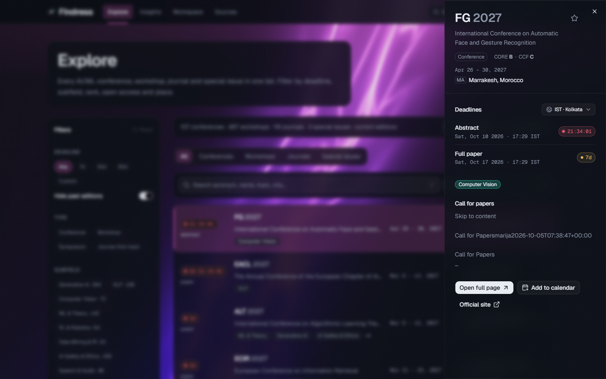</td>
    <td width="50%">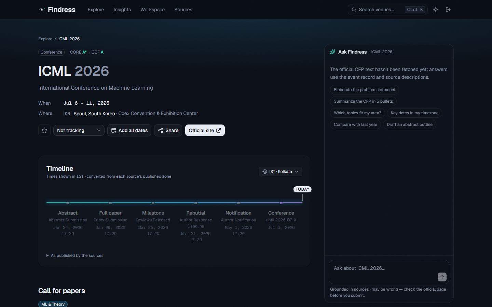</td>
  </tr>
  <tr>
    <td align="center"><sub><b>Explore</b> — filter, sort, preview without leaving the list</sub></td>
    <td align="center"><sub><b>Event page</b> — deadlines, CFP and the assistant</sub></td>
  </tr>
  <tr>
    <td width="50%">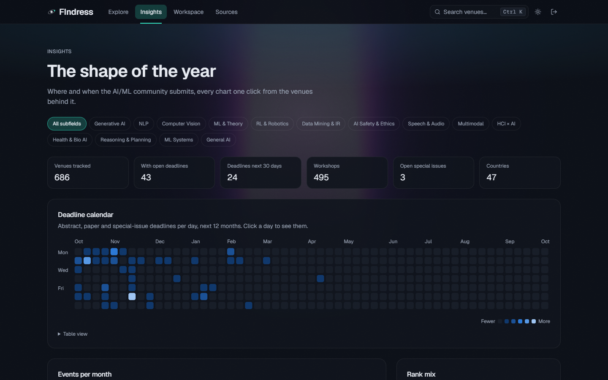</td>
    <td width="50%">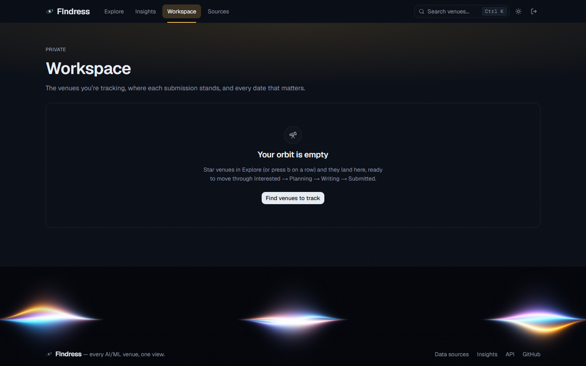</td>
  </tr>
  <tr>
    <td align="center"><sub><b>Insights</b> — where and when the field publishes</sub></td>
    <td align="center"><sub><b>Workspace</b> — track your own submissions</sub></td>
  </tr>
  <tr>
    <td width="50%">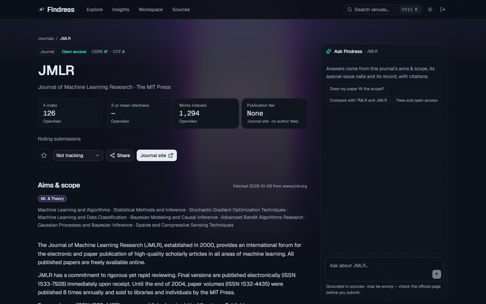</td>
    <td width="50%">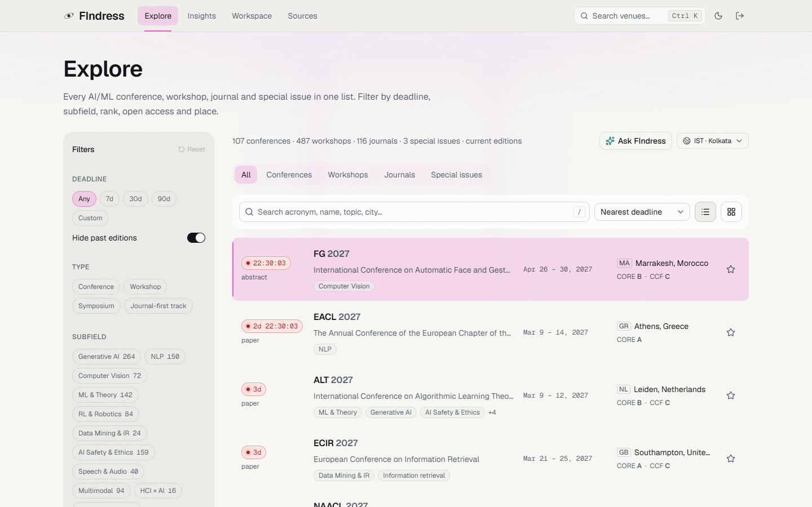</td>
  </tr>
  <tr>
    <td align="center"><sub><b>Journals</b> — metrics, ranks and special issues</sub></td>
    <td align="center"><sub><b>Light mode</b> — equally finished</sub></td>
  </tr>
</table>

<details>
<summary><b>Mobile (390 px)</b></summary>
<br/>
<p align="center">
  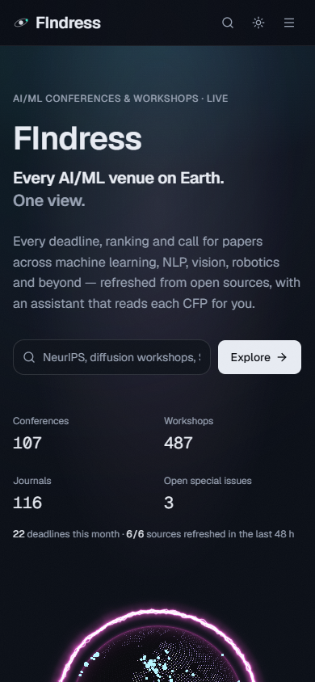
  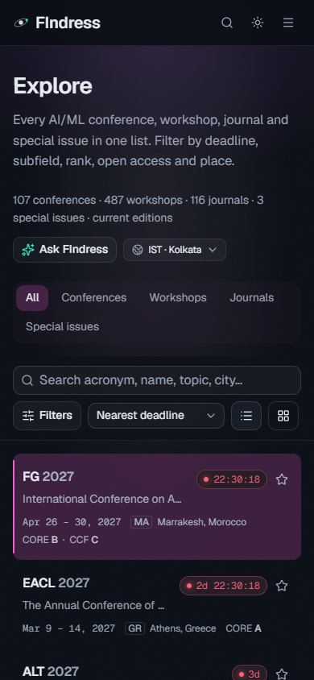
  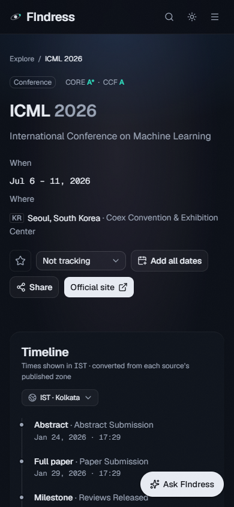
  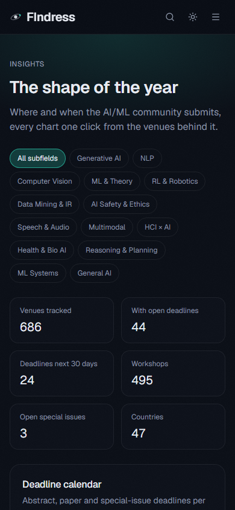
</p>
</details>

## Architecture

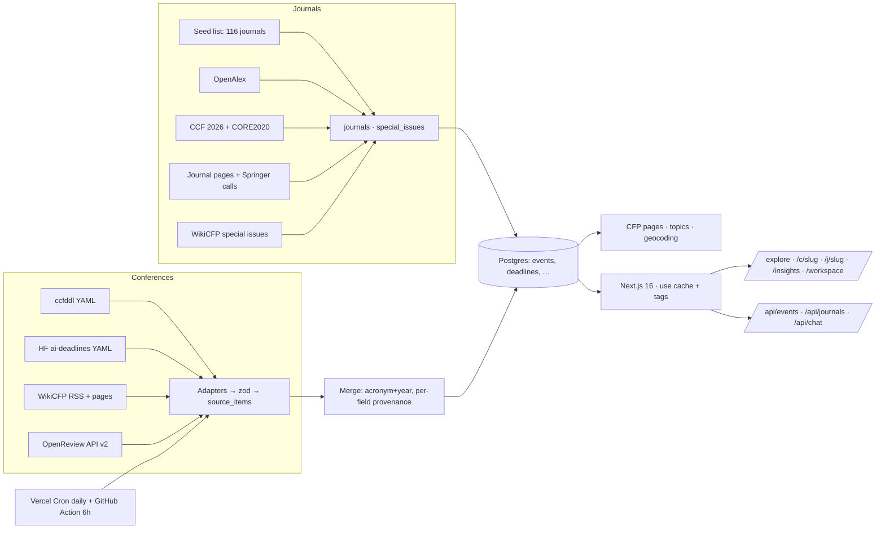

Every source goes through its own adapter and a zod schema before it touches the database. Events are
merged across sources by normalized acronym + year, and every field keeps its provenance. One failing
source never stops the others.

## Tech stack

| Layer | Choice |
|---|---|
| App | Next.js 16 (App Router, Server Components, `use cache`), React 19, TypeScript (strict) |
| UI | Tailwind CSS 4, shadcn/ui (Radix), Framer Motion, Three.js / cobe globe, Recharts, TanStack Virtual |
| Data | Neon Postgres, Drizzle ORM + drizzle-kit, PGlite (WASM Postgres) for local dev and tests |
| Ingestion | `yaml`, `rss-parser`, `cheerio`, `@mozilla/readability` + `linkedom`, OpenAlex, OpenReview |
| Assistant | Vercel AI SDK — Gemini by default, provider-swappable |
| Quality | Vitest (240+ unit tests), Playwright smoke suite (desktop + mobile), ESLint, Prettier, GitHub Actions CI |
| Hosting | Vercel (Git integration + Cron) |

## Run locally

Requires Node 22 and pnpm (`corepack enable`).

```bash
pnpm install
cp .env.example .env.local   # fill in what you need
pnpm db:local                # PGlite (WASM Postgres) on :54329, foreground — or set DATABASE_URL to Neon
pnpm db:migrate
pnpm ingest                  # all sources; or --steps=ccfddl,huggingface,openreview,wikicfp,merge,cfp,
                             #   topics,geocode,journals,journal-ranks,journal-pages,special-issues
pnpm dev                     # http://localhost:3000 — sign in at /login with APP_PASSWORD
```

```bash
pnpm test                    # unit tests
pnpm test:e2e                # Playwright, against `pnpm build && pnpm start`
pnpm typecheck && pnpm lint
```

## Configuration

All variables are documented in [`.env.example`](.env.example). The main ones:

| Variable | Purpose |
|---|---|
| `DATABASE_URL` | Postgres connection (Neon in production, PGlite locally) |
| `APP_PASSWORD`, `AUTH_SECRET` | Owner login and session signing |
| `CRON_SECRET` | Bearer token for the ingestion endpoint |
| `AI_PROVIDER`, `AI_MODEL`, `GOOGLE_GENERATIVE_AI_API_KEY` | Assistant provider (`google` by default; `anthropic` and `gateway` also supported) |
| `OPENALEX_API_KEY` / `OPENALEX_EMAIL` | Optional, for journal metrics |
| `NEXT_PUBLIC_SITE_URL`, `NEXT_PUBLIC_DEFAULT_TIMEZONE` | Public URL and default display timezone |

Deploying to Vercel? Every variable, the GitHub Actions secrets and the post-deploy checks are in
[`docs/DEPLOY.md`](docs/DEPLOY.md).

## Data ingestion

- **Schedule:** Vercel Cron calls `GET /api/ingest?source=<step>` daily (with `Authorization: Bearer $CRON_SECRET`),
  and [`.github/workflows/ingest.yml`](.github/workflows/ingest.yml) calls each step every 6 hours.
  A second daily cron refreshes journals, ranks, journal pages and special issues.
- **Journals:** the seed list ([`src/data/journals-seed.ts`](src/data/journals-seed.ts)) was verified title by
  title against OpenAlex, with print/online ISSNs from Crossref. Metrics come from OpenAlex, ranks from the
  CCF 2026 list and the CORE2020 journal list, and scope text and calls from the journals' own pages.
- **Polite by design:** identifies as `FIndressBot/1.0`, respects robots.txt, at most one request per second
  per host (5 s for WikiCFP). Every run is logged in `source_runs`, and the owner can trigger
  "Refresh now" from `/sources`.

## API

| Endpoint | Returns |
|---|---|
| `GET /api/events` | Events, filtered like `/explore`: `q`, `type`, `subfield`, `rank`, `window` (`7\|30\|90\|custom` + `from`/`to`), `passed`, `evfrom`, `evto`, `continent`, `country`, `mode`, `abstract`, `rebuttal`, `blind`, `community`, `sort`, `limit` (≤200), `offset`. Responds `{ total, limit, offset, items[] }`, cached `s-maxage=300`. |
| `GET /api/events/{slug}` | Full record with deadlines, CFP text and sources |
| `GET /api/events/{slug}/ics` | Calendar file |
| `GET /api/journals` | Journals: `q`, `subfield`, `oa`, `apcmax`, `jrank`, `publisher`, `jsort`, `limit`, `offset`; `include=special` adds open special issues |
| `GET /api/journals/{slug}` · `/ics` | Journal record with special issues · calendar file |

The app and its API sit behind the owner login. Without a session, pages redirect to `/login?next=…`
and API routes answer `401`. Open routes: `/login`, `/api/auth/*`, `/api/ingest` and `/api/revalidate`
(`CRON_SECRET` bearer), `/api/workspace/ics` (private feed token) and static assets.

## Project structure

```
src/
├── app/            # routes: explore, c/[slug], j/[slug], insights, workspace, sources, api/
├── components/     # UI, grouped by area
├── data/           # journal seed list and static data
└── lib/
    ├── ingest/     # one adapter per source, merge, CFP extraction, geocoding
    ├── db/         # Drizzle schema and queries
    ├── ai/         # assistant model selection and grounding
    ├── explore/  insights/  journals/  workspace/  time/
scripts/            # ingest, migrate, local-db, backups, screenshots
drizzle/            # SQL migrations
tests/e2e/          # Playwright smoke suite
docs/               # SPEC, DESIGN, DEPLOY, screenshots
```

Further reading: [product spec](docs/SPEC.md) · [design brief](docs/DESIGN.md) · [deployment guide](docs/DEPLOY.md).

## License

[MIT](LICENSE) © Barnak Roy Nandy
